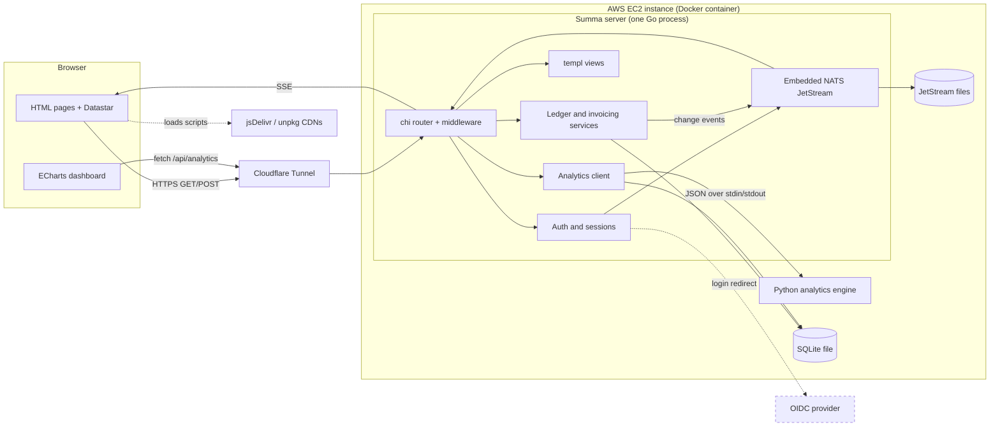

# Summa: Use Cases, Requirements, and Feature Plan

**Team:** Summa
**Members:** Sawyer Evans, David Kendall, Ryan Phillips, Graham Taggart
**Last updated:** 11/24/2026

## Contents

1. [Product vision](#1-product-vision)
2. [Use Cases](#2-use-cases)
3. [Workflows](#3-workflows)
4. [Architecture](#4-architecture)
5. [Features](#5-features)
6. [Personnel](#6-personnel)
7. [Development Process](#7-development-process)
8. [Changes since week 12 feedback](#8-changes-since-week-12-feedback)

---

## 1. Product vision

> DRAFT, adapted from slides 1-2 of the demo presentation. Rewrite in the team's own words.

Summa is a web-based accounting system for small businesses whose books are a team responsibility, not one accountant's. Existing tools (QuickBooks, Sage Intacct, Xero) are slow, costly, and built for a single trained user, so sharing the books usually means exporting a spreadsheet. Summa gives the whole team one live double-entry ledger they can open and edit together in real time, with every change recorded so anyone can trace the books back change by change.

### Actors

> DRAFT. The three human roles come from the "Owner, editor and viewer roles" goal on slide 8. Confirm the names and what each may do.

| Actor                               | Description                                                                                           | Goals they bring to the system                                                                          |
|-------------------------------------|-------------------------------------------------------------------------------------------------------|---------------------------------------------------------------------------------------------------------|
| Owner                               | The person who created the organization in Summa (business owner or lead accountant). Administers it. | Set up the organization, invite teammates and assign roles, lock periods, do everything an Editor can   |
| Editor (bookkeeper)                 | A teammate who records and corrects financial activity. May not be a trained accountant.              | Post journal entries, create and post invoices, record payments, manage customers, review flagged items |
| Viewer                              | A teammate or stakeholder with read-only access (manager, investor, outside accountant).              | See the dashboard, reports, timeline and analytics without being able to change the books               |
| Identity provider (external system) | An OIDC/OAuth2 provider used for sign-in (F-14).                                                      | Authenticate a person and return their identity to Summa                                                |
| System (scheduled / background)     | Summa itself acting without a user: session expiry, analytics refresh after a ledger change.          | Keep sessions short-lived, keep forecasts current                                                       |

---

## 2. Use Cases

### 2.1 Use case index

> DRAFT. The list comes from the routes, schema, sidebar navigation, and branches in the repo.
> **[TEAM: confirm which 3-5 are Primary.]** Five are marked here, which is the maximum.
> Feature IDs refer to section 5.

| ID    | Title                                      | Actor                 | Primary? | Status             | Workflows               | Features         |
|-------|--------------------------------------------|-----------------------|----------|--------------------|-------------------------|------------------|
| UC-01 | Sign up and create an organization         | Owner                 | No       | Active             | WF-01a                  | F-03, F-06       |
| UC-02 | Log in and log out                         | Owner, Editor, Viewer | No       | Active             | WF-02a                  | F-03             |
| UC-03 | Manage my account                          | Owner, Editor, Viewer | No       | Active             | WF-03a                  | F-03, F-19       |
| UC-04 | Change organization settings               | Owner                 | No       | Active             | WF-04a                  | F-19             |
| UC-05 | Invite members and assign roles            | Owner                 | No       | Active             | WF-05a                  | F-16             |
| UC-06 | Post a journal entry                       | Editor                | **Yes**  | Active             | WF-06a (chosen), WF-06b | F-01, F-10       |
| UC-07 | Edit the books together in real time       | Editor                | **Yes**  | Active             | WF-07a (chosen), WF-07b | F-10, F-01       |
| UC-08 | Invoice a customer and record payment      | Editor                | **Yes**  | Active             | WF-08a (chosen), WF-08b | F-04, F-01, F-12 |
| UC-09 | Trace a change on the timeline             | Editor, Viewer        | **Yes**  | Active             | WF-09a (chosen), WF-09b | F-11, F-33       |
| UC-10 | Review the cash forecast and flagged items | Owner, Editor         | **Yes**  | Active             | WF-10a (chosen), WF-10b | F-02             |
| UC-11 | Manage customers                           | Editor                | No       | Active             | WF-11a                  | F-12             |
| UC-12 | Manage the chart of accounts               | Owner, Editor         | No       | Active             | WF-12a                  | F-18, F-01       |
| UC-13 | View the dashboard                         | Owner, Editor, Viewer | No       | Active             | WF-13a                  | F-15             |
| UC-14 | View financial reports                     | Owner, Editor, Viewer | No       | Active             | WF-14a                  | F-13             |
| UC-15 | Reset a forgotten password                 | Owner, Editor, Viewer | No       | Active             | WF-15a                  | F-03             |
| UC-16 | Sign in with an external provider          | Owner, Editor, Viewer | No       | Active             | WF-16a                  | F-14             |
| UC-17 | Expire an idle session                     | System                | No       | Active             | WF-17a                  | F-03             |
| UC-18 | Reverse a posted transaction               | Editor                | No       | Active             | WF-18a                  | F-01, F-11       |
| UC-19 | Refresh analytics after the ledger changes | System                | No       | Active             | WF-19a                  | F-02             |
| UC-20 | Record a vendor bill and pay it            | Editor                | No       | **[TEAM: decide]** | WF-20a                  | F-17             |
| UC-21 | Import transactions from Excel / CSV       | Editor                | No       | **[TEAM: decide]** | WF-21a                  | F-30             |
| UC-22 | Close and lock a month                     | Owner                 | No       | **[TEAM: decide]** | WF-22a                  | F-20             |

### 2.2 Primary use cases

> DRAFT. Exception paths are taken from what the code already enforces (noted in parentheses) plus cases the team will have to decide. The team must be able to defend each one.

#### UC-06: Post a journal entry

- **Actor:** Editor
- **User story:** As an editor, I want to record a business event as a balanced journal entry so that the books reflect what actually happened.
- **Main success scenario:**
  1. Editor opens the General Journal and chooses "New entry".
  2. System shows an entry form with today's date, a description field, and two empty lines (account, debit or credit, amount).
  3. Editor enters the date and description, picks an account for each line, and enters amounts.
  4. System shows running debit and credit totals and whether they match.
  5. Editor adds more lines if needed and chooses "Post".
  6. System checks the entry, saves the transaction and all its lines together, and shows it at the top of the journal.
  7. System updates the journal, dashboard and timeline for everyone else viewing them.
- **Exceptions and alternates:**
  - 3a. The account the editor needs does not exist: editor creates it without leaving the form (UC-12), and the form keeps what was typed.
  - 5a. Debits do not equal credits: system refuses to post, shows the difference, and keeps the form (ledger rule 3; `ledger.PostInTx`).
  - 5b. Fewer than two lines: system refuses and explains that money must come from one account and go to another (ledger rule 1).
  - 5c. A zero or negative amount, or a missing direction: system marks the line and refuses (schema `CHECK (amount > 0)`).
  - 5d. The date falls in a locked month: system refuses and names the locked period (UC-22). **[TEAM: only if period locks are in scope.]**
  - 6a. Saving fails partway: nothing is saved, the editor sees an error and can retry with the form intact (single database transaction, ledger rule 2).
  - 6b. Connection lost before the response: on reconnect the system shows whether the entry posted, so the editor does not post it twice. **[TEAM: decide how duplicates are prevented, e.g. an idempotency key per form.]**
  - 6c. Viewer attempts to post: system refuses; the "New entry" control is not shown to viewers.
  - Alternate: the editor made a mistake in an already-posted entry. Posted entries are never edited; see UC-18.
- **Touches:** database (accounts, transactions, entries), authentication and sessions, authorization (roles), NATS (change notification), SSE stream to browsers
- **Related workflow:** WF-06a (chosen), WF-06b (alternative)
- **Features:** F-01, F-10
- **Prepared by / reviewed by:** [TEAM] / [TEAM]

#### UC-07: Edit the books together in real time

- **Actor:** Editor (two or more at once)
- **User story:** As an editor, I want to see my teammates' changes the moment they make them so that we can work on the same books without overwriting each other or exporting spreadsheets.
- **Main success scenario:**
  1. Editor A and Editor B each open the General Journal.
  2. System shows each of them the current journal and how many people are online.
  3. Editor A double-clicks a cell, changes a value, and saves.
  4. System stores the change, records it in the history, and pushes it to every open browser.
  5. Editor B sees the changed cell update and flash without reloading; totals recalculate.
  6. Both editors see the same journal.
- **Exceptions and alternates:**
  - 3a. A and B edit the same cell at nearly the same time: the server applies edits in the order it receives them; the later one wins, both editors see the final value, and both edits appear in the timeline. **[TEAM: confirm last-write-wins, or warn the second editor that the cell changed under them.]**
  - 3b. B is mid-edit when A's change to a different cell arrives: B's unsaved input is kept and A's change still appears.
  - 4a. The edit would unbalance the ledger: system rejects it and A's cell returns to its previous value with an explanation.
  - 4b. The saved values are identical to what the server has: nothing is stored and no history entry is created (the demo already diffs before storing).
  - 5a. B's live connection drops: system shows a "reconnecting" state, and on reconnect B receives the current journal, not a stale one.
  - 5b. B's session expires while watching (UC-17): the stream ends and B is sent to the login page.
  - 2a. A viewer has the journal open: they see live updates but cannot enter edit mode.
- **Touches:** NATS JetStream (key-value bucket and watch), SSE stream to browsers (Datastar), database (transactions, entries), authentication and sessions, authorization (roles)
- **Related workflow:** WF-07a (chosen), WF-07b (alternative)
- **Features:** F-10, F-01
- **Prepared by / reviewed by:** [TEAM] / [TEAM]

> Note for the team: the current `/demo` journal edits period totals directly in a NATS key-value bucket. `docs/ledger-rules.md` says this violates rule 6 and that the real UI must post entries. The exception paths above assume the post-entries design.

#### UC-08: Invoice a customer and record payment

- **Actor:** Editor
- **User story:** As an editor, I want to bill a customer and record when they pay so that receivables and revenue in the ledger are always correct.
- **Main success scenario:**
  1. Editor opens Invoices and chooses "New invoice".
  2. System shows a draft with the next invoice number, today's issue date, and a customer picker.
  3. Editor picks a customer, sets the due date, and adds lines (description, quantity, unit price).
  4. System shows the running total.
  5. Editor chooses "Post invoice".
  6. System posts a balanced entry (debit Accounts Receivable, credit Revenue) for the total, links it to the invoice, and marks the invoice posted.
  7. Later, editor opens the invoice and chooses "Record payment", entering the amount and date.
  8. System posts a balanced entry (debit Cash, credit Accounts Receivable) and shows the invoice's remaining balance.
- **Exceptions and alternates:**
  - 3a. The customer does not exist yet: editor adds the customer inline (UC-11) and returns to the draft.
  - 3b. Quantity is zero or negative, or price is negative: system marks the line and does not save it (schema checks).
  - 5a. The invoice has no lines or totals zero: system refuses to post ("invoice total must be positive").
  - 5b. The invoice number is already used in this organization: system refuses and suggests the next free number (unique per organization).
  - 5c. Someone else already posted this invoice: system says so and shows the posted invoice; no second ledger entry is created (`ErrAlreadyPosted`).
  - 5d. The receivable or revenue account is missing or the wrong type: system names the problem and links to the chart of accounts.
  - 6a. Posting fails partway: neither the ledger entry nor the "posted" link is saved (one database transaction).
  - 6b. Editor tries to add or change a line after posting: system refuses; a posted invoice is corrected with a reversal (UC-18).
  - 7a. Payment is more than the remaining balance: system refuses, or records the excess as a customer credit. **[TEAM: decide.]**
  - 7b. Partial payment: system records it and shows the invoice as partly paid with the remaining balance.
  - Alternate: editor saves the draft without posting and returns to it later.
- **Touches:** database (customers, invoices, invoice_lines, accounts, transactions, entries), authentication and sessions, authorization (roles), NATS and SSE (so open dashboards update)
- **Related workflow:** WF-08a (chosen), WF-08b (alternative)
- **Features:** F-04, F-01, F-12
- **Prepared by / reviewed by:** [TEAM] / [TEAM]

> Note for the team: invoice posting exists and is tested (`internal/invoicing`). Recording a payment (steps 7-8) is not in the current branch, and there is no email delivery of invoices. Decide whether "send invoice" is in scope; if so it adds an email service to section 4.5.

#### UC-09: Trace a change on the timeline

- **Actor:** Editor or Viewer
- **User story:** As a team member, I want to see who changed the books, when, and what they changed so that I can trust the numbers and find mistakes.
- **Main success scenario:**
  1. User opens the Timeline.
  2. System shows every change to the ledger, newest first, with who made it, when, and a summary.
  3. User filters by date range, account, or person.
  4. System shows only the matching changes.
  5. User selects a change.
  6. System shows the before and after values for that change and links to the affected entry.
  7. New changes made by others appear at the top while the user is watching.
- **Exceptions and alternates:**
  - 2a. No changes yet: system shows an empty state explaining that changes will appear here.
  - 4a. The filter matches nothing: system says so and offers to clear the filter.
  - 2b. The history is long: system loads it in pages and keeps scrolling responsive.
  - 7a. The live connection drops: system shows "reconnecting" and fills in missed changes on reconnect, with no duplicates.
  - 6a. The change is a reversal: system links the reversal and the original to each other.
  - Alternate: user picks two points in time and asks for the difference between the books at those moments (F-33).
- **Touches:** NATS JetStream (history, watch), SSE stream to browsers, database (transactions, entries, users), authentication and sessions
- **Related workflow:** WF-09a (chosen), WF-09b (alternative)
- **Features:** F-11, F-33
- **Prepared by / reviewed by:** [TEAM] / [TEAM]

> Note for the team: the timeline currently replays up to 64 revisions of the demo KV bucket, held in memory per request, with no author recorded. `docs/ledger-rules.md` lists "where the log lives" (NATS or SQLite as system of record) as an open decision; this use case depends on it.

#### UC-10: Review the cash forecast and flagged items

- **Actor:** Owner or Editor
- **User story:** As an owner, I want to see where cash is heading and which transactions look unusual so that I can act before there is a problem.
- **Main success scenario:**
  1. User opens Analytics.
  2. System loads the organization's cash movements from the ledger, runs the forecast, and shows a summary, a projected cash balance chart with a confidence band, and where cash moved.
  3. User switches the chart between cash balance and daily cash flow.
  4. System redraws the chart.
  5. User reads the "Needs attention" table of unusual expenses and possible duplicates, each with the reason it was flagged.
  6. User marks an item as reviewed.
  7. System records the review and stops highlighting the item; the ledger itself is not changed.
- **Exceptions and alternates:**
  - 2a. The organization has no cash entries: system shows an empty state that explains what to record first, not an error.
  - 2b. Fewer than 28 days of history: system falls back to the 7-day average, and says which method was used and why.
  - 2c. The analytics engine fails or takes longer than 10 seconds: system shows "analytics is unavailable" with a retry, and the rest of the app keeps working.
  - 2d. The user's role may not see analytics: system refuses. **[TEAM: decide whether Viewers see analytics.]**
  - 5a. Nothing is flagged: system says so plainly.
  - 6a. The flagged transaction was reversed since the page loaded: system removes it from the list on refresh.
  - Alternate: the forecast was refreshed in the background after a ledger change (UC-19), so the page opens immediately from the cached result.
- **Touches:** database (accounts, transactions, entries, review flags), analytics engine (Python subprocess), authentication and sessions, authorization (roles), third-party CDN (ECharts)
- **Related workflow:** WF-10a (chosen), WF-10b (alternative)
- **Features:** F-02
- **Prepared by / reviewed by:** [TEAM] / [TEAM]

> Note for the team: step 6 (mark reviewed) is described in the README but not built. `analytics.go` currently hardcodes organization 1 "until auth exists".

### 2.3 Other use cases

> DRAFT. Shorter, same template.

#### UC-01: Sign up and create an organization

- **Actor:** Owner
- **User story:** As a business owner, I want to create an account and my organization so that I can start keeping books in Summa.
- **Main success scenario:**
  1. Visitor opens the sign-up page.
  2. System shows a form for name, email, password, and organization name.
  3. Visitor submits the form.
  4. System creates the user, the organization with a starter chart of accounts, and a session, then opens the dashboard.
- **Exceptions and alternates:**
  - 3a. Email already registered: system says so and offers log in or password reset.
  - 3b. Password shorter than 12 or longer than 128 characters: system explains the rule (limits already defined in `internal/security`).
  - 3c. Invalid email or empty organization name: system marks the field.
  - Alternate: sign up through an external provider (UC-16).
- **Touches:** database (users, organizations, accounts), authentication (Argon2id password hashing), sessions (NATS KV)
- **Related workflow:** WF-01a
- **Features:** F-03, F-06
- **Prepared by / reviewed by:** [TEAM] / [TEAM]

#### UC-02: Log in and log out

- **Actor:** Owner, Editor, Viewer
- **User story:** As a member, I want to log in and out so that only my team can see our books.
- **Main success scenario:**
  1. User opens the login page and enters email and password.
  2. System verifies the password, creates a session, sets the session cookie, and opens the dashboard.
  3. Later, user chooses "Log out".
  4. System deletes the session and returns to the login page.
- **Exceptions and alternates:**
  - 2a. Wrong email or password: system shows one generic message that does not reveal which was wrong.
  - 2b. Repeated failures: system slows or temporarily blocks further attempts. **[TEAM: decide the limit.]**
  - 2c. User opened a protected page while logged out: after login the system returns them to that page.
- **Touches:** database (users), authentication, sessions (NATS KV)
- **Related workflow:** WF-02a
- **Features:** F-03
- **Prepared by / reviewed by:** [TEAM] / [TEAM]

#### UC-03: Manage my account

- **Actor:** Owner, Editor, Viewer
- **User story:** As a member, I want to change my name, email, and password so that my account stays accurate and secure.
- **Main success scenario:**
  1. User opens account settings.
  2. System shows name, email, and a change-password form.
  3. User edits a field and saves.
  4. System saves the change and confirms.
- **Exceptions and alternates:**
  - 3a. New email already in use: system refuses.
  - 3b. Changing the password requires the current password; a wrong one is refused.
  - 4a. After a password change, the user's other sessions are ended.
- **Touches:** database (users), authentication, sessions (NATS KV)
- **Related workflow:** WF-03a
- **Features:** F-03, F-19
- **Prepared by / reviewed by:** [TEAM] / [TEAM]

#### UC-04: Change organization settings

- **Actor:** Owner
- **User story:** As an owner, I want to set my organization's name and accounting defaults so that documents and reports are correct.
- **Main success scenario:**
  1. Owner opens Settings.
  2. System shows organization name and defaults (for example default receivable and revenue accounts, invoice number prefix).
  3. Owner changes a value and saves.
  4. System saves it and applies it to new documents.
- **Exceptions and alternates:**
  - 1a. An Editor or Viewer opens Settings: system shows it read-only or refuses.
  - 3a. A default account is of the wrong type: system refuses and explains.
- **Touches:** database (organizations, accounts), authentication and sessions, authorization (roles)
- **Related workflow:** WF-04a
- **Features:** F-19
- **Prepared by / reviewed by:** [TEAM] / [TEAM]

#### UC-05: Invite members and assign roles

- **Actor:** Owner
- **User story:** As an owner, I want to add teammates and control what each can do so that the right people can edit and others can only look.
- **Main success scenario:**
  1. Owner opens Members.
  2. System lists current members with their roles.
  3. Owner invites a person by email and picks a role (Editor or Viewer).
  4. System creates the invitation and shows it as pending.
  5. Owner changes a member's role or removes a member.
  6. System applies the change immediately, including to that member's open sessions.
- **Exceptions and alternates:**
  - 3a. The person is already a member: system says so.
  - 5a. Owner tries to remove or demote the last Owner: system refuses.
  - 6a. A removed member has the app open: their next action sends them to the login page.
  - 4a. How the invitation is delivered (email, or a link the owner copies). **[TEAM: decide; email adds a third-party service.]**
- **Touches:** database (users, organizations, memberships), authentication and sessions (NATS KV, revocation), authorization (roles)
- **Related workflow:** WF-05a
- **Features:** F-16
- **Prepared by / reviewed by:** [TEAM] / [TEAM]

#### UC-11: Manage customers

- **Actor:** Editor
- **User story:** As an editor, I want to keep a list of customers so that I can invoice them without retyping their details.
- **Main success scenario:**
  1. Editor opens Customers.
  2. System lists the organization's customers by name.
  3. Editor adds or edits a customer (name, email).
  4. System saves it and shows the updated list.
- **Exceptions and alternates:**
  - 2a. No customers yet: system shows an empty state with "Add your first customer".
  - 3a. Name is empty: system marks the field.
  - 3b. Editor tries to delete a customer that has invoices: system refuses and explains.
- **Touches:** database (customers), authentication and sessions, authorization (roles)
- **Related workflow:** WF-11a
- **Features:** F-12
- **Prepared by / reviewed by:** [TEAM] / [TEAM]

#### UC-12: Manage the chart of accounts

- **Actor:** Owner, Editor
- **User story:** As an editor, I want to add and organize accounts so that entries are recorded in the right place.
- **Main success scenario:**
  1. User opens Chart of Accounts.
  2. System lists accounts with type and current balance.
  3. User adds an account with a name and type (asset, liability, equity, revenue, expense).
  4. System saves it; it is available immediately in entry forms.
- **Exceptions and alternates:**
  - 3a. An account with that name already exists: system refuses.
  - 3b. User tries to change the type of an account that has entries: system refuses, because the type decides how balances are calculated.
  - 3c. User tries to delete an account that has entries: system refuses and offers to archive it.
- **Touches:** database (accounts, entries), authentication and sessions, authorization (roles)
- **Related workflow:** WF-12a
- **Features:** F-18, F-01
- **Prepared by / reviewed by:** [TEAM] / [TEAM]

#### UC-13: View the dashboard

- **Actor:** Owner, Editor, Viewer
- **User story:** As a member, I want a one-page summary of the books so that I know where things stand today.
- **Main success scenario:**
  1. User logs in or chooses Dashboard.
  2. System shows cash position, receivables, payables, net income, receivables aging, overdue invoices, items needing review, and recent activity, all calculated from the ledger.
  3. User selects a figure or item.
  4. System opens the page with the detail behind it.
- **Exceptions and alternates:**
  - 2a. A new organization with no entries: system shows zeros and a short "get started" guide, not blank cards.
  - 2b. Another member posts an entry while the dashboard is open: the affected figures update.
  - 2c. Analytics is unavailable: the "needs review" card says so; the rest of the dashboard still loads.
- **Touches:** database (accounts, transactions, entries, invoices, customers), analytics engine, authentication and sessions, NATS and SSE
- **Related workflow:** WF-13a
- **Features:** F-15
- **Prepared by / reviewed by:** [TEAM] / [TEAM]

#### UC-14: View financial reports

- **Actor:** Owner, Editor, Viewer
- **User story:** As an owner, I want a balance sheet, income statement, and cash flow view for any period so that I can understand and share the state of the business.
- **Main success scenario:**
  1. User opens Reports and picks a report and a period.
  2. System calculates the report from ledger entries for that period and shows it.
  3. User selects a line.
  4. System shows the entries that make up that amount.
- **Exceptions and alternates:**
  - 2a. No entries in the period: system shows the report with zeros and says the period is empty.
  - 1a. End date before start date: system refuses.
  - 2b. The balance sheet does not balance: system shows a clear integrity warning (this should never happen; ledger rule 8).
- **Touches:** database (accounts, transactions, entries), authentication and sessions
- **Related workflow:** WF-14a
- **Features:** F-13
- **Prepared by / reviewed by:** [TEAM] / [TEAM]

#### UC-15: Reset a forgotten password

- **Actor:** Owner, Editor, Viewer
- **User story:** As a member, I want to reset my password so that I can get back in if I forget it.
- **Main success scenario:**
  1. User chooses "Forgot password" and enters their email.
  2. System says that if the email is registered, reset instructions have been sent.
  3. User opens the reset link and enters a new password.
  4. System saves the new password, ends the user's other sessions, and opens the login page.
- **Exceptions and alternates:**
  - 2a. Email is not registered: system shows the same message, so it does not reveal who has an account.
  - 3a. The link is expired or already used: system says so and offers a new one.
  - 3b. New password fails the length rule: system explains.
  - 2b. How the link is delivered. **[TEAM: decide; email delivery adds a third-party service. A `/auth/reset` route already exists as a stub.]**
- **Touches:** database (users, reset tokens), authentication, sessions (NATS KV), email service (if chosen)
- **Related workflow:** WF-15a
- **Features:** F-03
- **Prepared by / reviewed by:** [TEAM] / [TEAM]

#### UC-16: Sign in with an external provider

- **Actor:** Owner, Editor, Viewer; Identity provider
- **User story:** As a member, I want to sign in with an account I already have so that I don't need another password.
- **Main success scenario:**
  1. User chooses "Continue with [provider]" on the login page.
  2. System sends the user to the provider.
  3. User approves at the provider.
  4. Provider returns the user to Summa with proof of identity.
  5. System verifies it, finds or creates the matching user, creates a session, and opens the dashboard.
- **Exceptions and alternates:**
  - 3a. User cancels at the provider: system returns to the login page with a neutral message.
  - 5a. The response fails verification (state mismatch, bad signature, expired): system refuses and logs it.
  - 5b. The email matches an existing password account: **[TEAM: decide whether to link automatically or require a password login first.]**
  - 2a. The provider is unreachable: system says so; password login still works.
- **Touches:** identity provider (OIDC/OAuth2), database (users), authentication, sessions (NATS KV)
- **Related workflow:** WF-16a
- **Features:** F-14
- **Prepared by / reviewed by:** [TEAM] / [TEAM]

#### UC-17: Expire an idle session

- **Actor:** System
- **User story:** As the system, I want sessions to end on their own so that an unattended browser cannot be used to read or change the books.
- **Main success scenario:**
  1. A session reaches its time limit (one hour in the current code).
  2. System removes the session.
  3. The user's next request finds no session.
  4. System sends the user to the login page and, after login, back to where they were.
- **Exceptions and alternates:**
  - 3a. The user had unsaved input in a form: **[TEAM: decide whether it is preserved across re-login.]**
  - 3b. The user has a live stream open (journal, timeline): the stream ends and the page shows "session expired".
  - 1a. Whether activity extends the session (sliding expiry) or not. **[TEAM: decide.]**
- **Touches:** sessions (NATS KV with per-key TTL), authentication
- **Related workflow:** WF-17a
- **Features:** F-03
- **Prepared by / reviewed by:** [TEAM] / [TEAM]

#### UC-18: Reverse a posted transaction

- **Actor:** Editor
- **User story:** As an editor, I want to undo a mistaken entry without erasing history so that the books are correct and still auditable.
- **Main success scenario:**
  1. Editor opens a posted transaction and chooses "Reverse".
  2. System shows the reversing entry it will post (same accounts, debits and credits swapped) and asks for a reason.
  3. Editor confirms.
  4. System posts the reversal, links it to the original, and shows both in the journal and timeline.
- **Exceptions and alternates:**
  - 1a. The transaction was already reversed: system says so and links to the reversal.
  - 1b. The transaction belongs to a posted invoice: system explains the effect on the invoice before reversing.
  - 3a. The reversal date falls in a locked month: system refuses (UC-22).
- **Touches:** database (transactions, entries, invoices), authentication and sessions, authorization (roles), NATS and SSE
- **Related workflow:** WF-18a
- **Features:** F-01, F-11
- **Prepared by / reviewed by:** [TEAM] / [TEAM]

#### UC-19: Refresh analytics after the ledger changes

- **Actor:** System
- **User story:** As the system, I want to recompute the forecast when cash entries change so that the analytics page opens quickly and is never stale.
- **Main success scenario:**
  1. A transaction touching the Cash account is posted.
  2. System schedules an analytics run for that organization.
  3. System runs the engine and stores the result.
  4. The next visit to Analytics or the dashboard uses the stored result.
- **Exceptions and alternates:**
  - 2a. Many entries are posted in quick succession: system runs once after they settle, not once per entry.
  - 3a. The run fails or times out: system keeps the previous result, marks it with its age, and retries later.
- **Touches:** NATS (ledger change events), analytics engine (Python subprocess), database (accounts, transactions, entries, cached results), background job
- **Related workflow:** WF-19a
- **Features:** F-02
- **Prepared by / reviewed by:** [TEAM] / [TEAM]

> **[TEAM: write UC-20, UC-21, UC-22 if they stay in scope, or move them to 2.4.]** Bills and period locks exist on an unmerged branch (commit `acbd28f`); Excel/CSV import is listed as a semester goal on slide 8.

### 2.4 Out of scope and retired use cases

> **[TEAM: move anything here that you are deliberately not building, with a reason.]** Candidates the sidebar currently links to but nothing implements: Vendors, Help.

| ID | Title | Status       | Reason |
|----|-------|--------------|--------|
|    |       | Out of scope |        |

---

## 3. Workflows

### 3.1 Conventions

> DRAFT, read from `views/summa_shell.templ` and the CSS.

- **Navigation:** Fixed left sidebar on every signed-in page, grouped as Workspace, Money in, Money out, Accounting, with Settings and Help at the bottom. On narrow screens the sidebar becomes a header with a menu button that opens the same links. The Summa wordmark always returns to the Dashboard.
- **Page header:** Every page starts with a small section label, the page title, and a one-line description.
- **Terminology:** "General Journal" (not "ledger page"), "Timeline" for change history, "entry" for one debit or credit line, "transaction" for a balanced group of entries, "post" for saving to the ledger, "Needs attention" / "Needs review" for flagged items. **[TEAM: pick one of the last two and use it everywhere.]**
- **Layout patterns:** Content in cards on a light background; tables for lists; amounts right-aligned. **[TEAM: where the primary action button goes, and how errors are shown (inline under the field vs. a banner).]**
- **Editing pattern:** Double-click a cell to edit in place; Save and Cancel appear with the edit. Changes from others flash briefly.
- **Platforms:** Web only, responsive down to phone width.

### 3.2 Primary workflows

> The tables below are DRAFT and describe screens that exist today or follow directly from the use case. **[TEAM: add the sketch or screenshot for each, and the click counts.]**

#### WF-06a: Post a journal entry from the General Journal (chosen) — for UC-06

| Screen | UC step | What the user does | Reads | Writes |
|---|---|---|---|---|
| 1. General Journal | 1 | Chooses "New entry" | transactions, entries, accounts | none |
| 2. Entry form (in place, above the journal) | 2-5 | Enters date, description, lines; watches totals; chooses "Post" | accounts | none until Post |
| 3. General Journal with the new entry on top | 6-7 | Sees the entry appear | transactions, entries | transactions, entries; change event |

**Step count:** [TEAM: N screens, N clicks/taps to complete]

**Unhappy paths:**

| Exception | Screen or message shown | Sketch |
|---|---|---|
| 5a. Debits and credits differ | Totals row turns red with the difference; Post is disabled |  |
| 5b. Fewer than two lines | Message under the lines |  |
| 5c. Invalid amount | Field marked, message under it |  |
| 6a. Save failed | Banner with Retry; form unchanged |  |
| 6b. Offline / lost connection | "Reconnecting" indicator; Post disabled until back |  |
| Empty state (no entries yet) | Explanation and "Post your first entry" |  |
| Loading state | [TEAM] |  |

#### WF-06b: [TEAM: title] (alternative) — for UC-06

> Idea to sketch: a guided form for non-accountants ("I paid rent", "I made a sale") that asks plain questions and builds the debit and credit lines for them. Compare its step count and error rate against the raw entry form.

| Screen | UC step | What the user does | Reads | Writes |
|---|---|---|---|---|
| 1 | | | | |
| 2 | | | | |

**Step count:** [TEAM]

**Why we chose WF-06a over WF-06b:** [TEAM: compare step counts, discoverability, how each handles failure, user needs]

#### WF-07a: Edit in place with live updates (chosen) — for UC-07

> This is the existing `/demo` General Journal. A screenshot of two browsers side by side works as the sketch.

| Screen | UC step | What the user does | Reads | Writes |
|---|---|---|---|---|
| 1. General Journal (view mode), "N online" shown | 1-2 | Opens the page | journal state; presence count | presence count |
| 2. General Journal (edit mode) | 3 | Double-clicks a cell, types, chooses Save | journal state | changed cells only; history revision |
| 3. General Journal (view mode) on every browser | 4-6 | Sees the changed cell flash and totals update | pushed update | none |

**Step count:** [TEAM]

**Unhappy paths:**

| Exception | Screen or message shown | Sketch |
|---|---|---|
| 3a. Same cell edited by two people | [TEAM: final value shown to both; whether the second editor is warned] |  |
| 4a. Edit rejected (unbalanced) | Cell returns to previous value with a message |  |
| 5a. Offline / lost connection | "Reconnecting" indicator; edits disabled |  |
| 5b. Session expired | "Session expired" then login |  |
| 2a. Viewer role | No edit mode on double-click |  |

#### WF-07b: [TEAM: title] (alternative) — for UC-07

> Idea to sketch: row locking. Opening an entry for edit shows "Ryan is editing" to everyone else and blocks their edits until he saves or cancels. More steps and waiting, but no conflicting edits.

**Why we chose WF-07a over WF-07b:** [TEAM]

#### WF-08a: Invoice from the Invoices list (chosen) — for UC-08

| Screen | UC step | What the user does | Reads | Writes |
|---|---|---|---|---|
| 1. Invoices list | 1 | Chooses "New invoice" | invoices, customers | none |
| 2. Invoice draft | 2-5 | Picks customer, dates, adds lines, chooses "Post invoice" | customers, next invoice number | invoices, invoice_lines |
| 3. Posted invoice | 6 | Sees the posted invoice with its total and balance due | invoices, invoice_lines | transactions, entries, invoice posted link |
| 4. Record payment (on the invoice) | 7-8 | Enters amount and date, confirms | invoice balance, accounts | transactions, entries |

**Step count:** [TEAM]

**Unhappy paths:**

| Exception | Screen or message shown | Sketch |
|---|---|---|
| 3b. Invalid quantity or price | Line marked, message under it |  |
| 5a. No lines / zero total | "Add at least one line" and Post disabled |  |
| 5b. Duplicate invoice number | Message with the next free number |  |
| 5c. Already posted by someone else | Posted invoice shown with a notice |  |
| 7a. Overpayment | [TEAM] |  |
| Empty state (no invoices) | Explanation and "Create your first invoice" |  |
| Offline / lost connection | [TEAM] |  |

#### WF-08b: [TEAM: title] (alternative) — for UC-08

> Idea to sketch: start from the customer ("Customers > Acme > New invoice") so the customer is already chosen, or start from the dashboard's "New" button.

**Why we chose WF-08a over WF-08b:** [TEAM]

#### WF-09a: Timeline as a live list (chosen) — for UC-09

> The existing `/timeline` page covers screens 1 and the live update. Filtering and the detail view are not built.

| Screen | UC step | What the user does | Reads | Writes |
|---|---|---|---|---|
| 1. Timeline | 1-2, 7 | Opens the page; watches new changes arrive | change history | none |
| 2. Timeline with filters applied | 3-4 | Picks date range, account, or person | change history | none |
| 3. Change detail | 5-6 | Selects a change; reads before and after | change history, transactions, entries | none |

**Step count:** [TEAM]

**Unhappy paths:**

| Exception | Screen or message shown | Sketch |
|---|---|---|
| 2a. No changes yet | Empty state |  |
| 4a. Filter matches nothing | "No changes match" with "Clear filters" |  |
| 7a. Offline / lost connection | "Reconnecting" indicator |  |
| Loading a long history | [TEAM] |  |

#### WF-09b: [TEAM: title] (alternative) — for UC-09

> Idea to sketch: a scrubber on the General Journal itself. Dragging it back shows the journal as it was at that moment (the demo page already has a "Play" control).

**Why we chose WF-09a over WF-09b:** [TEAM]

#### WF-10a: Analytics page (chosen) — for UC-10

> The existing `/analytics` page covers screens 1 and 2.

| Screen | UC step | What the user does | Reads | Writes |
|---|---|---|---|---|
| 1. Analytics: summary, projected cash chart, where cash moved | 1-2 | Opens the page | cash entries, forecast result | none |
| 2. Same page, chart toggled | 3-4 | Switches between "Cash balance" and "Daily cash flow" | forecast result | none |
| 3. "Needs attention" table | 5-7 | Reads reasons; marks an item reviewed | flagged items | review flag (never the ledger) |

**Step count:** [TEAM]

**Unhappy paths:**

| Exception | Screen or message shown | Sketch |
|---|---|---|
| 2a. No cash entries | Empty state explaining what to record first |  |
| 2b. Too little history | Note naming the simpler method in use |  |
| 2c. Engine failed or timed out | "Analytics is unavailable" with Retry |  |
| 5a. Nothing flagged | "Nothing needs attention" |  |
| Loading state | [TEAM] |  |

#### WF-10b: [TEAM: title] (alternative) — for UC-10

> Idea to sketch: no separate page. The forecast and flagged items live on the dashboard cards, and each flag links straight to its transaction.

**Why we chose WF-10a over WF-10b:** [TEAM]

### 3.3 Other workflows

> **[TEAM: one sketch and table for each of WF-01a through WF-05a and WF-11a through WF-19a.]** The Dashboard (WF-13a) already exists and can be a screenshot. Template:

#### WF-01a: [Title] — for UC-01

| Screen | UC step | What the user does | Reads | Writes |
|---|---|---|---|---|
| 1 | | | | |

### 3.4 High-fidelity mockups (optional)

> Must match the chosen workflow and its step numbering. Label AI-generated ones.

| Workflow | Screen | Image | AI-generated? |
|---|---|---|---|
| | | | |

---

## 4. Architecture

### 4.1 Overview diagram

> DRAFT, drawn from `main.go`, `nats.go`, `internal/`, the Dockerfile, and the AWS deployment branch. GitLab wikis render Mermaid. Dashed boxes are planned, not built.

A browser request reaches the Go server through a Cloudflare Tunnel; the EC2 instance accepts no inbound connections. The chi router checks the session, runs a handler that reads or writes SQLite through sqlc-generated queries, and returns HTML rendered on the server by templ. Anything that changes the ledger goes through one server process and one database transaction, so the ledger has a single writer and cannot fork.

For real-time updates, a page opens a long-lived Server-Sent Events connection. When a change is stored, the server publishes it on the embedded NATS server; every handler holding an open stream receives it and pushes a small HTML patch that Datastar merges into the page. Analytics runs out of process: Go loads the organization's cash movements, sends only those to a Python script as JSON, and returns the script's JSON result to the charts in the browser.

### 4.2 Components

| Component             | What it is and does                                                                                                                                                                                                                                | Talks to                                        | Used by (UC IDs)                            |
|-----------------------|----------------------------------------------------------------------------------------------------------------------------------------------------------------------------------------------------------------------------------------------------|-------------------------------------------------|---------------------------------------------|
| Front end             | Server-rendered HTML (templ) with Datastar for reactivity. No single-page app and almost no hand-written JavaScript. Opens SSE streams for live pages.                                                                                             | Go server (HTTP, SSE), CDNs                     | All                                         |
| Go server (back end)  | One Go binary: chi router, middleware (request ID, logging, panic recovery, cross-origin protection), one routes file per feature. Owns all authorization and all database access.                                                                 | SQLite, embedded NATS, analytics engine         | All                                         |
| Database              | SQLite file in WAL mode with foreign keys on. Schema managed by goose migrations run at startup; queries and types generated by sqlc. Tables: organizations, users, accounts, transactions, entries, customers, invoices, invoice_lines.           | Go server only                                  | All except UC-17                            |
| Ledger service        | `internal/ledger`: posts a transaction and its entries atomically, refuses unbalanced or single-line transactions, derives balances from entries.                                                                                                  | Database                                        | UC-06, 07, 08, 12, 13, 14, 18               |
| Invoicing service     | `internal/invoicing`: posts an invoice to the ledger exactly once, in the same database transaction as the ledger entries.                                                                                                                         | Database, ledger service                        | UC-08                                       |
| Authentication        | `internal/security`: Argon2id password hashing with constant-time comparison; random 32-byte session tokens in an HttpOnly, Secure cookie.                                                                                                         | Database, session store                         | UC-01, 02, 03, 15, 16, 17                   |
| Session store         | A NATS JetStream key-value bucket (`session_manager`). Each session key has a one-hour time-to-live, so NATS removes expired sessions itself; logout deletes the key.                                                                              | Embedded NATS                                   | UC-02, 05, 17, and every signed-in use case |
| Authorization (roles) | Planned. Owner, Editor, Viewer per organization, checked on every route.                                                                                                                                                                           | Database, session store                         | UC-04, 05, 06, 07, 08, 10                   |
| Real-time messaging   | NATS server embedded in the Go process (no network listener), with JetStream persistence on disk. Carries change events and keeps revision history.                                                                                                | Go server, local disk                           | UC-06, 07, 09, 13, 19                       |
| SSE stream            | Long-lived HTTP responses through which the server pushes HTML patches to open pages.                                                                                                                                                              | Front end, real-time messaging                  | UC-06, 07, 09, 13                           |
| Analytics engine      | `analytics/engine.py` (Python, statsmodels), started by Go as a subprocess per run with a 10-second limit. Forecasts cash flow (Holt-Winters vs. 7-day mean, chosen by backtest) and flags outlier and duplicate expenses. Has no database access. | Go server (stdin/stdout JSON)                   | UC-10, 13, 19                               |
| Background job        | Planned. Re-runs analytics after ledger changes and caches the result.                                                                                                                                                                             | Real-time messaging, analytics engine, database | UC-19                                       |
| Identity provider     | Planned. External OIDC/OAuth2 provider for sign-in.                                                                                                                                                                                                | Go server                                       | UC-16                                       |
| Email service         | **[TEAM: only if password reset, invitations, or invoices are sent by email.]**                                                                                                                                                                    | Go server                                       | UC-05, 15                                   |

> No object storage is used. If CSV import (UC-21) or invoice PDFs are added, decide where uploaded and generated files live.

### 4.3 Deployment target

- **Kind of system:** Web app, responsive for phone and desktop browsers.

> DRAFT. Details come from `Dockerfile`, `compose.yaml`, and the AWS deployment commits (`d4bf4b2`, `26ecd34`), which are not on the current branch. **[TEAM: confirm this is still the plan.]**

| Component                                  | Where it runs                                                                                                                       | Provider           |
|--------------------------------------------|-------------------------------------------------------------------------------------------------------------------------------------|--------------------|
| Go server, embedded NATS, analytics engine | One Docker container (Debian slim, non-root user) on a single EC2 instance (t3.small, Amazon Linux 2023), started by Docker Compose | AWS EC2            |
| SQLite database and JetStream files        | A Docker volume mounted at `/app/data` on the instance's encrypted EBS disk                                                         | AWS EBS            |
| Container image                            | Private image repository                                                                                                            | AWS ECR            |
| Public HTTPS entry point                   | Cloudflare Tunnel (`cloudflared` on the instance); the instance's security group allows no inbound traffic                          | Cloudflare         |
| Secrets (tunnel token)                     | Parameter Store                                                                                                                     | AWS SSM            |
| Infrastructure definition                  | CloudFormation template plus deploy scripts                                                                                         | AWS CloudFormation |
| CI                                         | Self-hosted Docker runner (GitLab CI), mirrored on GitHub Actions                                                                   | capstone GitLab    |
| Front-end libraries                        | Loaded by the browser at run time                                                                                                   | jsDelivr, unpkg    |

### 4.4 Key decisions

> The "Why" paragraphs are DRAFT, written from what the code and docs show. **The team must rewrite these in its own words and be able to defend them.** The assignment asks for two or three; four are listed.

#### Decision 1: Frameworks

- **We chose:** Go on the server with chi (routing), templ (HTML rendered on the server), and Datastar (reactivity over SSE).
- **Main alternative considered:** [TEAM: e.g. a React or Svelte single-page app with a JSON API]
- **Why:** hypermedia over SSE gave real-time updates without a front-end framework. With one server rendering HTML there is one copy of the state and one place to validate, which matters for accounting. It also keeps the codebase to one main language for four people. [TEAM: what did you give up, e.g. offline use, rich client-side interaction?]

#### Decision 2: Database

- **We chose:** SQLite
- **Main alternative considered:** PostgreSQL, MongoDB, raw JSON
- **Why:** DRAFT. Summa runs as a single server process, so a database embedded in that process needs no separate server to deploy, secure, or pay for, and backups are one file. SQLite gives real transactions, foreign keys, and CHECK constraints, which the ledger rules depend on (atomic posts, positive amounts, valid directions); raw JSON and MongoDB would not enforce those. WAL mode with immediate transaction locks is enough for one writer. PostgreSQL would be the choice if the app needed several server instances or heavy concurrent writes. [TEAM: confirm, and note the limits you accept, such as one writer at a time and dates stored as text.]

#### Decision 3: Hosting

- **We chose:** AWS EC2
- **Main alternative considered:** GCP Compute Engine, Vercel, Cloudflare Hosting
- **Why:** DRAFT. The app is a long-running process that holds open SSE connections, keeps an embedded NATS server in memory, and writes a SQLite file to local disk. Serverless and edge platforms (Vercel, Cloudflare) are built for short, stateless requests with no durable local disk, so they do not fit. A plain virtual machine does. Between EC2 and Compute Engine: [TEAM: credits, familiarity, the existing CloudFormation and ECR setup?]

#### Decision 4: Real-time enabler

- **We chose:** NATS.io (embedded, with JetStream)
- **Main alternative considered:** RabbitMQ, Redis, Kafka
- **Why:** DRAFT. NATS can be embedded in the Go binary, so there is no extra service to run; RabbitMQ, Redis, and Kafka are all separate servers. JetStream adds a persistent key-value store with revision history and per-key time-to-live, which the team reuses for two other jobs: the change history behind the timeline and the session store. Kafka is far more than a single small server needs. [TEAM: confirm, and state the trade-off, e.g. sessions and history share fate with the app process.]

> Open decision recorded in `docs/ledger-rules.md` that belongs here once made: whether NATS JetStream or SQLite is the system of record for the change log.

### 4.5 Third-party services and AI components

> DRAFT. Costs are left for the team to look up; do not guess them. No AI or LLM API is used at run time: forecasting is a local statistical model.

| Service                               | Used for                                       | Expected cost                                        | Latency                                   | If it goes down, the app...                                                                                                 |
|---------------------------------------|------------------------------------------------|------------------------------------------------------|-------------------------------------------|-----------------------------------------------------------------------------------------------------------------------------|
| AWS EC2 + EBS                         | Runs the whole application and stores its data | [TEAM: t3.small on-demand plus 20 GB gp3, per month] | Not on the request path as a separate hop | is completely unavailable. Data survives on the EBS volume; recovery is a redeploy. [TEAM: backup plan for the SQLite file] |
| AWS ECR                               | Stores the container image                     | [TEAM]                                               | Only at deploy time                       | keeps running; new deploys are blocked                                                                                      |
| AWS SSM Parameter Store               | Holds the Cloudflare tunnel token              | [TEAM: standard parameters]                          | Only at instance start                    | keeps running; a new instance cannot start                                                                                  |
| Cloudflare Tunnel                     | Public HTTPS entry point and TLS               | [TEAM: free plan?]                                   | Adds one network hop to every request     | is unreachable from the internet even though the server is healthy                                                          |
| OIDC provider (planned) [TEAM: which] | External sign-in (UC-16)                       | [TEAM]                                               | One redirect round trip at login only     | still allows password login; external sign-in shows an error                                                                |
| jsDelivr CDN                          | Datastar and ECharts scripts                   | Free                                                 | Browser download, cached                  | renders pages but live updates, in-place editing, and charts stop working. Mitigation: serve these files from `/assets`.    |
| unpkg CDN                             | Lucide icons                                   | Free                                                 | Browser download, cached                  | works without icons. Same mitigation.                                                                                       |
| Email service (undecided)             | Password reset, invitations                    | [TEAM]                                               | [TEAM]                                    | [TEAM]                                                                                                                      |

---

## 5. Features

> Rank names follow the assignment's rank table (Essential / Defining / Advanced).
> The assignment also says "Distinctive", "Base", and "Planned" in places; confirm with course staff and rename here and in GitLab labels if needed.

### 5.1 Feature index

> Owners and ranks the team entered are kept as written. Titles and use cases in rows the team left blank are DRAFT proposals.
> **Changes from the team's version:** the second F-10 row was removed (duplicate ID); F-05 and F-06 were added for infrastructure the rank table calls Essential; F-15 to F-20 were added so every use case has a feature.
> **[TEAM: three things to resolve]**
> 1. F-02 and F-04 are ranked Essential, but the assignment defines Essential as infrastructure the system cannot run without. They read as Defining.
> 2. F-01 lists two owners. Each feature needs one named lead; split the rest into tasks.
> 3. Every member needs one individually owned Advanced feature. Slide 8's per-person goals are marked in the code as "assigned arbitrarily", so they are shown only as suggestions.

| ID   | Title                                                         | Rank      | Use cases                         | Owner                                        | GitLab issue |
|------|---------------------------------------------------------------|-----------|-----------------------------------|----------------------------------------------|--------------|
| F-01 | Double-entry ledger                                           | Essential | UC-06, UC-07, UC-08, UC-12, UC-18 | Sawyer Evans, Ryan Phillips [TEAM: one lead] | [#]()        |
| F-02 | Analytics: cash forecast and flagged items                    | Essential | UC-10, UC-19                      | David Kendall                                | [#]()        |
| F-03 | Log in, sign up, and sessions                                 | Essential | UC-01, UC-02, UC-03, UC-15, UC-17 | Graham Taggart                               | [#]()        |
| F-04 | Invoices and payments                                         | Essential | UC-08                             | Ryan Phillips                                | [#]()        |
| F-05 | Build, test, and deploy pipeline                              | Essential | Enables all                       | [TEAM]                                       | [#]()        |
| F-06 | Organization-scoped data model and migrations                 | Essential | UC-01; enables all                | [TEAM]                                       | [#]()        |
| F-10 | Real-time collaboration on the General Journal                | Defining  | UC-06, UC-07                      | [TEAM]                                       | [#]()        |
| F-11 | Ledger timeline (change history)                              | Defining  | UC-09, UC-18                      | [TEAM]                                       | [#]()        |
| F-12 | Customer management                                           | Defining  | UC-11, UC-08                      | [TEAM]                                       | [#]()        |
| F-13 | Financial reports: balance sheet, income statement, cash flow | Defining  | UC-14                             | [TEAM]                                       | [#]()        |
| F-14 | OIDC/OAuth2 login and sign-up                                 | Defining  | UC-16                             | Graham Taggart                               | [#]()        |
| F-15 | Dashboard computed from the ledger                            | Defining  | UC-13                             | [TEAM]                                       | [#]()        |
| F-16 | Members and roles (Owner, Editor, Viewer)                     | Defining  | UC-05                             | [TEAM]                                       | [#]()        |
| F-17 | Vendor bills and payments                                     | Defining  | UC-20                             | [TEAM: only if UC-20 is in scope]            | [#]()        |
| F-18 | Chart of accounts management                                  | Defining  | UC-12                             | [TEAM]                                       | [#]()        |
| F-19 | Account and organization settings                             | Defining  | UC-03, UC-04                      | [TEAM]                                       | [#]()        |
| F-20 | Month-end close and period lock                               | Defining  | UC-22                             | [TEAM: only if UC-22 is in scope]            | [#]()        |
| F-30 | [TEAM. Suggestion: Excel/CSV import into the ledger]          | Advanced  | UC-21                             | [TEAM]                                       | [#]()        |
| F-31 | [TEAM]                                                        | Advanced  |                                   | [TEAM]                                       | [#]()        |
| F-32 | [TEAM]                                                        | Advanced  |                                   | [TEAM]                                       | [#]()        |
| F-33 | Node Editor of Workflow Rules                                 | Advanced  | UC-09                             | Graham Taggart                               | [#]()        |

### 5.2 Essential features

> Acceptance criteria are DRAFT. "Already true" notes say what the current code does.

#### F-01: Double-entry ledger

- **Rank:** Essential
- **Use cases:** UC-06, UC-07, UC-08, UC-12, UC-18
- **Owner (lead):** Sawyer Evans, Ryan Phillips [TEAM: one lead]
- **Acceptance criteria:**
  - [ ] A transaction whose debits do not equal its credits, or that has fewer than two entries, is rejected and nothing is saved. (Already true in `ledger.PostInTx`, with tests.)
  - [ ] Posted transactions and entries cannot be updated or deleted through any route; corrections are made by posting a reversal that links to the original.
  - [ ] Every balance shown anywhere is calculated from entries; an automated test rebuilds all balances from the entries and confirms total debit-normal balances equal total credit-normal balances.
  - [ ] An entry cannot reference an account from a different organization than its transaction. (Listed as a known gap in `docs/ledger-rules.md`.)
  - [ ] Amounts are stored as integer cents and no ledger calculation uses floating point.

#### F-02: Analytics: cash forecast and flagged items

- **Rank:** Essential [TEAM: see note in 5.1]
- **Use cases:** UC-10, UC-19
- **Owner (lead):** David Kendall
- **Acceptance criteria:**
  - [ ] The Analytics page shows a 1 to 90 day cash forecast with a 95% band, built from the signed-in user's organization's posted cash entries, not the demo fixture or a hardcoded organization.
  - [ ] The page names the forecast method that was selected and its backtest error; with fewer than 28 days of history it uses the 7-day mean and says so.
  - [ ] Expense outliers (modified z-score of 3.5 or more) and same-day, same-amount, same-vendor duplicates are listed with a reason; marking one reviewed persists and never alters the ledger.
  - [ ] If the engine fails or exceeds 10 seconds, the page shows an "unavailable" message with retry, and every other page still works.
  - [ ] An organization with no cash entries sees an empty state, not an error.

> If the forecasting and anomaly work is meant to be David's individual showcase, consider splitting it into its own Advanced feature and leaving the basic analytics page here.

#### F-03: Log in, sign up, and sessions

- **Rank:** Essential
- **Use cases:** UC-01, UC-02, UC-03, UC-15, UC-17
- **Owner (lead):** Graham Taggart
- **Acceptance criteria:**
  - [ ] A visitor can sign up with email and a 12 to 128 character password; the password is stored only as an Argon2id hash. (Hashing exists in `internal/security`; the handlers in `auth.go` are empty stubs and `users` has no password column yet.)
  - [ ] Every route except login, sign-up, reset, health, and static assets redirects to login when there is no valid session.
  - [ ] A session expires one hour after creation and logout ends it immediately; an automated test shows an expired or deleted session is refused.
  - [ ] A wrong email and a wrong password produce the same message and response.
  - [ ] A user can reset a forgotten password with a single-use, expiring link, and doing so ends their other sessions.

#### F-04: Invoices and payments

- **Rank:** Essential [TEAM: see note in 5.1]
- **Use cases:** UC-08
- **Owner (lead):** Ryan Phillips
- **Acceptance criteria:**
  - [ ] An editor can create a draft invoice for a customer with one or more lines; the total is calculated from the lines.
  - [ ] Posting an invoice creates exactly one balanced ledger transaction (debit receivable, credit revenue) in the same database transaction; posting it twice, including two simultaneous attempts, never creates a second one. (Already true in `invoicing.PostInvoice`, with tests.)
  - [ ] Lines cannot be added to or changed on a posted invoice. (Add is already enforced in SQL.)
  - [ ] Recording a full or partial payment posts a balanced transaction (debit cash, credit receivable) and the invoice shows the remaining balance.
  - [ ] Invoice numbers are unique within an organization, and one organization can never read or post another's invoices.

#### F-05: Build, test, and deploy pipeline

- **Rank:** Essential
- **Use cases:** Enables all
- **Owner (lead):** [TEAM]
- **Acceptance criteria:**
  - [ ] Every merge request runs gofmt check, `go vet`, `go test ./...`, and `go build ./...` in GitLab CI and cannot merge on failure. (The job exists in `.gitlab-ci.yml`.)
  - [ ] A merge to `main` produces a container image and deploys it to the EC2 instance without manual steps on the server.
  - [ ] After a deploy, `/health` returns OK and the SQLite and JetStream data from before the deploy are intact.
  - [ ] The SQLite database is backed up on a schedule, and a restore from backup has been performed and documented.

#### F-06: Organization-scoped data model and migrations

- **Rank:** Essential
- **Use cases:** UC-01; enables all
- **Owner (lead):** [TEAM]
- **Acceptance criteria:**
  - [ ] All schema changes are goose migrations applied automatically at startup; a fresh database and an upgraded one end with the same schema.
  - [ ] Users belong to organizations through a membership that carries a role.
  - [ ] Every query that reads or writes business data is filtered by the signed-in user's organization; an automated test confirms a user in organization A cannot read or change organization B's accounts, transactions, customers, or invoices.
  - [ ] A new organization starts with a default chart of accounts.

### 5.3 Defining features

#### F-10: Real-time collaboration on the General Journal

- **Rank:** Defining
- **Use cases:** UC-06, UC-07
- **Owner (lead):** [TEAM]
- **Acceptance criteria:**
  - [ ] When one user saves a change, every other browser on the same organization's journal shows it within one second without reloading.
  - [ ] Edits change the ledger by posting entries, not by overwriting totals (ledger rule 6).
  - [ ] Two users saving the same cell at once leaves all browsers showing the same final value, and both edits appear in the timeline; an automated test reproduces this.
  - [ ] A browser that loses and regains its connection shows the current journal without a manual reload.
  - [ ] Updates for one organization are never delivered to another organization's browsers.

#### F-11: Ledger timeline (change history)

- **Rank:** Defining
- **Use cases:** UC-09, UC-18
- **Owner (lead):** [TEAM]
- **Acceptance criteria:**
  - [ ] Every posted transaction and reversal appears on the timeline with who made it and when, newest first.
  - [ ] The history survives a server restart and is not limited to the last 64 revisions.
  - [ ] The timeline can be filtered by date range, account, and person.
  - [ ] Selecting a change shows what it changed and links to the entry.
  - [ ] New changes appear at the top while the page is open.

#### F-12: Customer management

- **Rank:** Defining
- **Use cases:** UC-11, UC-08
- **Owner (lead):** [TEAM]
- **Acceptance criteria:**
  - [ ] An editor can add, edit, and list customers for their organization. (Create and list queries exist; there is no page on the current branch.)
  - [ ] A customer with invoices cannot be deleted.
  - [ ] A new customer can be created from inside the invoice draft without losing the draft.

#### F-13: Financial reports: balance sheet, income statement, cash flow

- **Rank:** Defining
- **Use cases:** UC-14
- **Owner (lead):** [TEAM]
- **Acceptance criteria:**
  - [ ] Each report can be run for any date range and is calculated only from posted entries.
  - [ ] The balance sheet satisfies assets = liabilities + equity for every test dataset.
  - [ ] The monthly scenarios recorded in `docs/ledger-rules.md` (October rent, October sale plus November rent) produce the stated amounts.
  - [ ] Selecting a report line lists the entries behind it.

#### F-14: OIDC/OAuth2 login and sign-up

- **Rank:** Defining
- **Use cases:** UC-16
- **Owner (lead):** Graham Taggart
- **Acceptance criteria:**
  - [ ] A user can sign up and log in through [TEAM: provider] and lands on the dashboard with a normal Summa session.
  - [ ] A callback with a missing or mismatched state value, an invalid signature, or an expired token is rejected.
  - [ ] If the provider is unreachable, password login still works and the user sees a clear message.
  - [ ] [TEAM: rule for an external identity whose email matches an existing password account.]

#### F-15: Dashboard computed from the ledger

- **Rank:** Defining
- **Use cases:** UC-13
- **Owner (lead):** [TEAM]
- **Acceptance criteria:**
  - [ ] Cash position, receivables, payables, and net income are calculated from the organization's ledger for the selected period. (The current dashboard shows hardcoded sample data.)
  - [ ] Receivables aging buckets and the overdue list match the organization's unpaid invoices.
  - [ ] A new organization sees zeros and a getting-started prompt.
  - [ ] Every sidebar link opens a working page; none point to placeholder anchors.

#### F-16: Members and roles (Owner, Editor, Viewer)

- **Rank:** Defining
- **Use cases:** UC-05
- **Owner (lead):** [TEAM]
- **Acceptance criteria:**
  - [ ] An owner can invite a person, change a member's role, and remove a member.
  - [ ] A viewer's request to any route that changes data is refused by the server, not only hidden in the page; an automated test covers each such route.
  - [ ] Removing a member or changing their role takes effect on their next request without waiting for their session to expire.
  - [ ] The last owner of an organization cannot be removed or demoted.

#### F-17: Vendor bills and payments

- **Rank:** Defining [TEAM: only if UC-20 is in scope]
- **Use cases:** UC-20
- **Owner (lead):** [TEAM]
- **Acceptance criteria:**
  - [ ] [TEAM]

#### F-18: Chart of accounts management

- **Rank:** Defining
- **Use cases:** UC-12
- **Owner (lead):** [TEAM]
- **Acceptance criteria:**
  - [ ] A user can add an account of any of the five types and see every account with its current balance.
  - [ ] The type of an account that has entries cannot be changed, and such an account cannot be deleted.
  - [ ] A new account is selectable in entry and invoice forms immediately.

#### F-19: Account and organization settings

- **Rank:** Defining
- **Use cases:** UC-03, UC-04
- **Owner (lead):** [TEAM]
- **Acceptance criteria:**
  - [ ] A user can change their name, email, and password; a password change requires the current password.
  - [ ] An owner can change the organization name and default accounts; editors and viewers cannot.
  - [ ] [TEAM]

#### F-20: Month-end close and period lock

- **Rank:** Defining [TEAM: only if UC-22 is in scope]
- **Use cases:** UC-22
- **Owner (lead):** [TEAM]
- **Acceptance criteria:**
  - [ ] [TEAM]

### 5.4 Advanced features

> One per team member at minimum. Individually owned, never shared, technically challenging.
> **[TEAM: these are yours to choose.]** Candidates visible in the repo and slides: Excel/CSV import into the ledger; diff the books between any two points in time; REST export; the forecasting and anomaly engine split out of F-02; a scrubber that replays the journal through time.

#### F-30: [TEAM]

- **Rank:** Advanced
- **Use cases:** [TEAM]
- **Owner (builder):** [TEAM]
- **Hard part:** [TEAM]
- **Acceptance criteria:**
  - [ ] [TEAM]
  - [ ] [TEAM]

#### F-31: [TEAM]

- **Rank:** Advanced
- **Use cases:** [TEAM]
- **Owner (builder):** [TEAM]
- **Hard part:** [TEAM]
- **Acceptance criteria:**
  - [ ] [TEAM]
  - [ ] [TEAM]

#### F-32: [TEAM]

- **Rank:** Advanced
- **Use cases:** [TEAM]
- **Owner (builder):** [TEAM]
- **Hard part:** [TEAM]
- **Acceptance criteria:**
  - [ ] [TEAM]
  - [ ] [TEAM]

#### F-33: [TEAM]

- **Rank:** Advanced
- **Use cases:** [TEAM]
- **Owner (builder):** Graham Taggart
- **Hard part:** [TEAM]
- **Acceptance criteria:**
  - [ ] [TEAM]
  - [ ] [TEAM]

### 5.5 Traceability check

**Use case to workflow to feature:**

| Use case | Workflow(s)    | Feature(s)       | OK?              |
|----------|----------------|------------------|------------------|
| UC-01    | WF-01a         | F-03, F-06       | [ ]              |
| UC-02    | WF-02a         | F-03             | [ ]              |
| UC-03    | WF-03a         | F-03, F-19       | [ ]              |
| UC-04    | WF-04a         | F-19             | [ ]              |
| UC-05    | WF-05a         | F-16             | [ ]              |
| UC-06    | WF-06a, WF-06b | F-01, F-10       | [ ]              |
| UC-07    | WF-07a, WF-07b | F-10, F-01       | [ ]              |
| UC-08    | WF-08a, WF-08b | F-04, F-01, F-12 | [ ]              |
| UC-09    | WF-09a, WF-09b | F-11, F-33       | [ ]              |
| UC-10    | WF-10a, WF-10b | F-02             | [ ]              |
| UC-11    | WF-11a         | F-12             | [ ]              |
| UC-12    | WF-12a         | F-18, F-01       | [ ]              |
| UC-13    | WF-13a         | F-15             | [ ]              |
| UC-14    | WF-14a         | F-13             | [ ]              |
| UC-15    | WF-15a         | F-03             | [ ]              |
| UC-16    | WF-16a         | F-14             | [ ]              |
| UC-17    | WF-17a         | F-03             | [ ]              |
| UC-18    | WF-18a         | F-01, F-11       | [ ]              |
| UC-19    | WF-19a         | F-02             | [ ]              |
| UC-20    | WF-20a         | F-17             | [ ] decide scope |
| UC-21    | WF-21a         | F-30             | [ ] decide scope |
| UC-22    | WF-22a         | F-20             | [ ] decide scope |

**Checklist:**

- [ ] Every major feature belongs to at least one use case
- [ ] Every use case has a workflow
- [ ] Every use case lists at least one feature, and its Features field in section 2 is updated
- [ ] Use cases we are not implementing are marked out of scope with a reason (section 2.4)

### 5.6 GitLab mirror check

- [ ] One issue per feature, titled "F-xx: Title", with acceptance criteria in the description
- [ ] Each feature issue has exactly one rank label (e.g. `Rank::Defining`)
- [ ] Major feature issues have use case labels (e.g. `UC::06`)
- [ ] Each issue is assigned to the feature's owner
- [ ] Shared features are split into tasks, each assigned to the person doing it

> `docs/ledger-rules.md` refers to existing issues #9 (Double-Entry Ledger Engine) and #10 (Git-Like Timeline). Retitle those as F-01 and F-11 instead of opening duplicates.

---

## 6. Personnel

### 6.1 Responsibilities

> Rows show only the ownership the team has already entered. **[TEAM: fill in roles and the unassigned features from 5.1.]**

| Member         | Team-wide role                           | Leads (Essential)               | Leads (Defining) | Owns (Advanced) |
|----------------|------------------------------------------|---------------------------------|------------------|-----------------|
| Graham Taggart | Merge Master, Security Expert, NATS Guru | F-03                            | F-14             | F-33            |
| Ryan Phillips  | [TEAM]                                   | F-04, F-01 (shared, to resolve) |                  | [TEAM]          |
| David Kendall  | [TEAM]                                   | F-02                            |                  | [TEAM]          |
| Sawyer Evans   | [TEAM]                                   | F-01 (shared, to resolve)       |                  | [TEAM]          |

### 6.2 How we divided the work

> DRAFT observation, not a decision. The ownership so far follows features, not layers: each person has built a slice from schema to page (Graham: demo, real-time, sessions and security; David: analytics engine and dashboard; Ryan: invoicing, NATS setup, deployment; Sawyer: ledger schema and posting, ledger rules).

[TEAM: state whether you are dividing by feature or by layer, and why that suits this project.]

### 6.3 Balance check

> Counts reflect section 5.1 as it stands. F-01 is counted for both listed owners until a single lead is chosen. Twelve Essential and Defining features and three Advanced features are still unassigned.

| Member         | Essential | Defining | Advanced | Total |
|----------------|-----------|----------|----------|-------|
| Graham Taggart | 1         | 1        | 1        | 3     |
| Ryan Phillips  | 2         | 1        | 0        | 2     |
| David Kendall  | 1         | 1        | 0        | 1     |
| Sawyer Evans   | 1         | 1        | 0        | 1     |

---

## 7. Development Process

> DRAFT, described from the repo's history and config. **[TEAM: correct anything that is not actually your practice, and fill in the gaps.]**

- **Branching and merging:** Work happens on short-lived branches named by type (`feature/`, `fix/`, `docs/`, `test/`, `refactor/`) and reaches `main` through GitLab merge requests. Commit messages mostly follow the conventional format (`feat(db): ...`, `fix(ui): ...`). [TEAM: who may merge; Graham is listed as Merge Master.]
- **Code review:** [TEAM: who reviews, how many approvals, what must pass before merge.] The team held a full code review after the interactive demo; its conclusions became the rules in `AGENTS.md`.
- **Testing:** Go unit and integration tests live next to the code they exercise (ledger, invoicing, database queries, analytics client, NATS). GitLab CI on the team's self-hosted Docker runner checks formatting (gofmt), then runs `go vet`, `go test ./...`, and `go build ./...` on every push, with Python installed so the analytics tests run. GitHub Actions mirrors the same checks. [TEAM: manual or end-to-end testing; who is testing lead.]
- **Issue tracking:** [TEAM: how GitLab issues, tasks, and the `Rank::` and `UC::` labels are used week to week.]
- **Review of AI-generated work:** `AGENTS.md` gives AI coding agents the project's rules (database is the source of truth, use sqlc-generated types, one routes file per feature, keep `main.go` minimal) and a checklist to pass before finishing a change. AI-generated code that is kept is labeled in comments. [TEAM: how a human reviews AI-written code before merge, and how the owner shows they understand it, since any member may be asked to explain or modify their feature.]
- **Money-handling rule:** Any code that touches money must follow `docs/ledger-rules.md` (double-entry, append-only, derived balances).
- **Keeping the plan in sync:** [TEAM: who updates this document and the GitLab issue together when a feature changes.]

---

## 8. Changes since week 12 feedback

> **[TEAM: record the feedback from the Nov 16-20 staff meeting and what changed because of it.]**

| Date | Section / ID | What changed | Why (feedback received) |
|------|--------------|--------------|-------------------------|
|      |              |              |                         |
